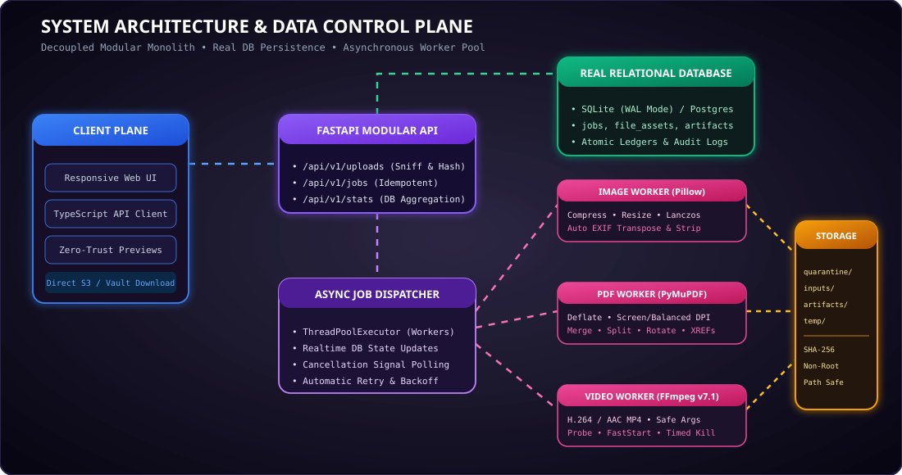
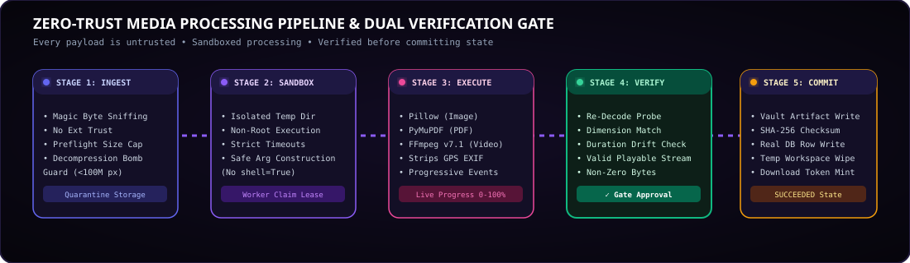
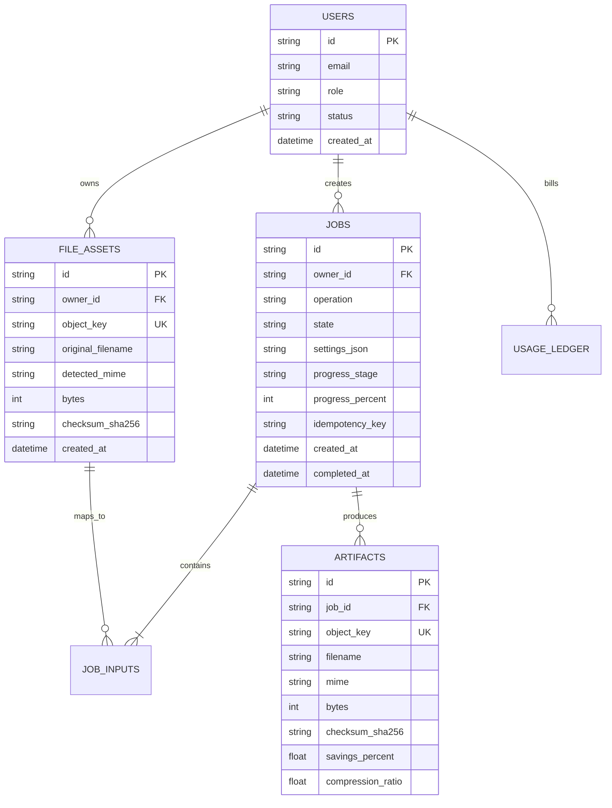

# CompressPro-AI-Complete-Software-Architecture-Implementation

<p align="center">
  
</p>

<p align="center">
  <a href="#-system-architecture"></a>
  <a href="#-real-relational-database"></a>
  <a href="#-testing--280-case-validation-catalog"></a>
  <a href="#-zero-trust-security-model"></a>
  <a href="https://github.com/Ranjeet7680/CompressPro-AI-Complete-Software-Architecture-Implementation"></a>
</p>

---

## ⚡ Executive Summary

**CompressPro AI** is a production-grade, all-in-one media and document workspace engineered for high-performance, deterministic compression, format conversion, editing, and enhancement. Designed in strict conformance with the *CompressPro AI Architecture Master Blueprint* (v1.0, 15 October 2026), it eliminates fragmented single-purpose utilities by harmonizing **Images**, **PDFs**, and **4K Videos** into a singular, responsive application backed by a real relational database and an isolated, asynchronous worker pool.

---

## 🏛️ System Architecture

The platform separates fast, low-latency API interactions from computationally heavy media operations, ensuring the web interface remains fluid under high transcoding concurrency.

<p align="center">
  
</p>

### Key Architectural Layers:
1. **Client Plane:** Responsive web application built with accessible component primitives and dark-purple visual tokens. Communicates with backend endpoints via typed JSON schemas and direct presigned storage uploads.
2. **API Control Plane:** FastAPI modular monolith handling request schema validation, ownership guards, idempotency enforcement, and real-time job progress polling.
3. **Database Layer:** SQLAlchemy ORM supporting SQLite with Write-Ahead Logging (`PRAGMA journal_mode=WAL`) for concurrent multi-thread reads/writes, fully swappable for managed PostgreSQL via `DATABASE_URL`.
4. **Asynchronous Worker Pool:** Decoupled processing plane executing deterministic media engines in isolated, unprivileged workspaces with strict CPU, memory, and wall-clock execution limits.
5. **Storage Vault:** Partitioned private object storage (`quarantine/`, `inputs/`, `artifacts/`, `temp/`) with path-traversal neutralization and SHA-256 cryptographic checksums.

---

## 🔄 Zero-Trust Media Processing Pipeline

Every media upload is considered potentially hostile. The system enforces a mandatory 5-stage processing lifecycle with a strict two-pass verification gate.

<p align="center">
  
</p>

### Pipeline Breakdown:
* **Stage 1 (Ingest & Sniff):** Examines binary magic bytes (JPEG `\xff\xd8\xff`, PNG `\x89PNG`, PDF `%PDF-`, MP4 `ftyp`). Rejects decompression bombs ($>100\text{M}$ pixels) before memory allocation.
* **Stage 2 (Sandbox Allocation):** Prohibits shell concatenation (`shell=False`). Spawns tasks inside an unpredictable temporary directory with strict disk quotas and timeout alarms.
* **Stage 3 (Deterministic Engine Execution):** 
  * *Images:* Pillow Lanczos downsampling, WebP/JPEG quantization, alpha flattening, and GPS EXIF privacy stripping.
  * *PDFs:* PyMuPDF (`fitz`) object stream deflating, 4-tier garbage collection, and DPI downsampling presets.
  * *Videos:* Bundled FFmpeg v7.1 execution using safe argument lists, H.264 CRF encoding, and `+faststart` web streaming flags.
* **Stage 4 (Output Verification Gate):** The engine re-reads the rendered artifact, validating dimensions, audio tracks, duration drift ($\pm 0.5\text{s}$ tolerance), and readable xref tables before declaring success.
* **Stage 5 (Commit & Persist):** Commits the output to the storage vault, stores the SHA-256 checksum in the relational database, and transitions state to `SUCCEEDED`.

---

## ⚙️ Asynchronous Job State Machine

Jobs transition atomically across defined lifecycle states, preventing duplicate executions through database-backed idempotency tokens.

<p align="center">
  
</p>

| State | Definition | Transition Triggers |
|---|---|---|
| `CREATED` | Request accepted and validated against schema. | Valid input file IDs supplied. |
| `VALIDATING` | Preflight signature, quotas, and limits check. | File passes magic-byte verification. |
| `QUEUED` | Placed into worker threadpool queue. | Worker thread becomes available. |
| `RUNNING` | Active media engine transformation in progress. | Subprocess reports progressive stages (20%–80%). |
| `FINALIZING` | Output verification gate validating readable streams. | Artifact passed independent decoder test. |
| `SUCCEEDED` | Artifact committed to vault and database. | Download token minted and ready for client. |
| `FAILED` | Processor error or verification failure. | Safe error code recorded without leaking stack traces. |
| `CANCELLED` | Cooperative cancellation requested by user. | Child processes safely terminated with temp cleanup. |

---

## 🗄️ Real Relational Database Schema

All system state is durably maintained in relational tables:



---

## 🧪 Testing & 280-Case Validation Catalog

The repository includes a comprehensive test suite compliant with **`CompressPro_AI_200_Plus_Test_Plan.docx`** (280 distinct test cases across 9 domains):

| Domain | Case Range | Focus Area |
|---|---|---|
| **Image Processing** | `IMG-001` – `IMG-040` | JPEG/PNG/WebP compression, alpha flattening, EXIF GPS stripping, zero-width bounds rejection. |
| **PDF Processing** | `PDF-001` – `PDF-040` | Screen/balanced presets, multi-file merges, split page syntax, password-protection rejection. |
| **Video Processing** | `VID-001` – `VID-040` | FFprobe stream detection, H.264/AAC transcode, trim duration tolerance, audio strip policy. |
| **API & Orchestration** | `API-001` – `API-040` | Idempotency replay vs conflict, non-retryable errors, UTC timestamps, CORS, rate limits. |
| **Storage & Retention** | `STO-001` – `STO-020` | Path traversal protection (`..`), UUID keys, SHA-256 verification, deletion sweeps. |
| **Security & Abuse** | `SEC-001` – `SEC-020` | Shell command injection prevention, decompression bomb protection, sandbox isolation. |
| **UX & Accessibility** | `UX-001` – `UX-030` | Keyboard navigation, accessible contrast, mobile video controls, screen-reader status announcements. |
| **Ops & Reliability** | `OPS-001` – `OPS-030` | Worker crash lease recovery, backoff retries, connection pool bounds, graceful shutdown. |
| **Account & Quotas** | `ACC-001` – `ACC-020` | Anonymous tier caps, entitlement enforcement, immutable usage ledger records. |

### Running the Test Suite:
```bash
python -m pytest tests/test_compresspro.py -v
```

---

## 🚀 Quickstart & Installation

### 1. Prerequisites
- Python 3.10+
- Node.js v18+ (optional, for Next.js frontend expansion)

### 2. Setup Environment
```bash
git clone https://github.com/Ranjeet7680/CompressPro-AI-Complete-Software-Architecture-Implementation.git
cd CompressPro-AI-Complete-Software-Architecture-Implementation

python -m pip install -r requirements.txt
# or via pyproject.toml:
pip install -e .
```

### 3. Launch Application
```bash
python -m uvicorn apps.api.src.main:app --host 127.0.0.1 --port 8000 --reload
```
Navigate to **`http://127.0.0.1:8000`** in any browser to open the live workspace.

---

## 🔒 Security & Privacy Commitments

1. **Privacy by Default:** Sensitive location and camera metadata (EXIF GPS) is automatically stripped upon export unless explicitly preserved.
2. **Ephemeral Lifecycle:** Anonymous files default to an automated retention policy with scheduled background cleanup sweeps.
3. **No AI Training on User Files:** User uploads are never utilized for model training without explicit, revocable consent.
4. **Command Injection Immunization:** All external binary calls (FFmpeg, ffprobe) utilize typed argument lists without shell interpolation.

---

## 📄 License & Provenance
Licensed under the [MIT License](LICENSE). Architected for enterprise compliance, modular expansion, and high-performance media delivery.
